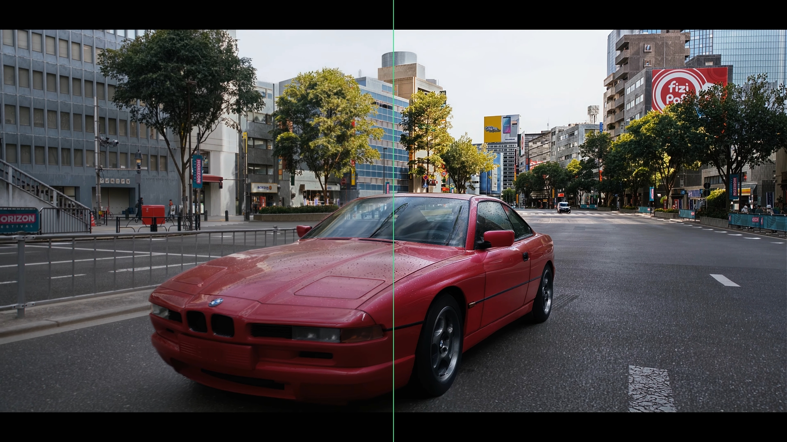
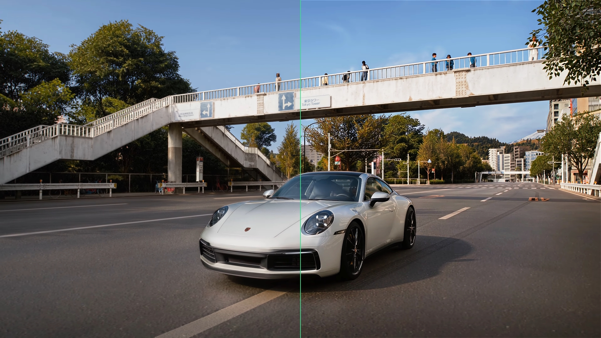

#### 🎬 VIDEO FILTER 1.0

**Google Chrome extension for real-time SVG video enhancement.**
Applies a customizable post-processing pipeline to **all web videos** without canvas frame copying or audio desync:
**Auto-Exposure** (adaptive night brightness) → **FakeHDR** → **LumaSharpen** → **FXAA**. 

🌐 **Language:** **English** | [Русский](./README_ru.md) 

#### ✨ Features

* **4-Stage Real-Time Pipeline:** Fine-tune adaptive night brightness, local contrast, luminance sharpening, and edge anti-aliasing via smooth sliders.
* **Before / After Split-Screen:** Compare original and processed video side-by-side (0%–100%) using a draggable vertical green divider rendered inside a single SourceGraphic.
* **Presets & JSON Backup:** Includes 5 built-in presets (*Original*, *Night*, *Cinema*, *Sharpen + FXAA*, *Flat*) plus custom preset saving, .json export, and import.
* **Bilingual Interface:** Instant **English / Russian** toggle (i18n.js) stored independently in vfPreferences (chrome.storage), keeping your active filter settings intact.

#### 🚀 Installation

1. Create a video-filter folder and place all extension files inside:
manifest.json, filter.js, i18n.js, content.js, background.js, popup.html, popup.css, popup.js.
2. Open chrome://extensions/ and enable **Developer mode** (top-right corner).
3. Click **Load unpacked** and select the video-filter folder.
4. Pin the **VIDEO FILTER** icon to your toolbar.

**Updating:** Replace the files in the folder, click the refresh icon (↻) in chrome://extensions/, and **reload open video tabs** so updated content scripts take effect. 

#### 🎛 Controls & Shortcuts

* **Open Panel:** Click the extension icon in the toolbar.
* **Toggle Filter:** Press Alt+Shift+F or use the **ON/OFF** switch in the header.
* **Toggle Stage:** Use the **Block Active** switch inside each of the 4 filter sections.
* **Before / After Mode:** Click **Show Line** to split the frame, drag **Line Position** (0%–100%), or click **Center** (50%). Click **Hide Line** to return to full-frame view. *(Note: Unavailable on protected Chrome pages and in Picture-in-Picture).*
* **Presets:** Click built-in preset chips, enter a name + **+ Save** to create your own, or click × to delete.
* **Backup & Reset:** Use **↓ Export .json**, **↑ Load .json**, **Reset**, or the site exclusion button at the bottom of the panel.

#### 🛠 How the Pipeline Works (SourceGraphic)

The incoming video stream passes through a sequential four-stage pipeline inside a single SVG filter: 

1. **Auto-Exposure:** Calculates a scene luminance map (feColorMatrix + wide feGaussianBlur), builds an adaptive brightness mask (feComponentTransfer), and lifts shadow details via feComposite.
2. **FakeHDR:** Extracts local micro-contrast through blur subtraction (feGaussianBlur + feComposite), shapes tonal balance with a 9-point curve (feComponentTransfer), and boosts color saturation (feColorMatrix).
3. **LumaSharpen:** Analyzes luminance transitions using dual opposing differences (±0.24) to crisp up edges without introducing color artifacts.
4. **FXAA:** Detects high-contrast edges (|L−B| with a noise cutoff threshold), generates an edge alpha mask, and smooths jagged stair-stepping strictly along object boundaries.

Finally, the processed output is blended with the original frame according to the mix ratio and clipped to the source alpha channel (operator="in").

*(Controlled via stage toggles enabled, aeOn, hdrOn, shOn, fxaaOn and 20 continuous filter parameters defaulting to the **Original** preset).*

