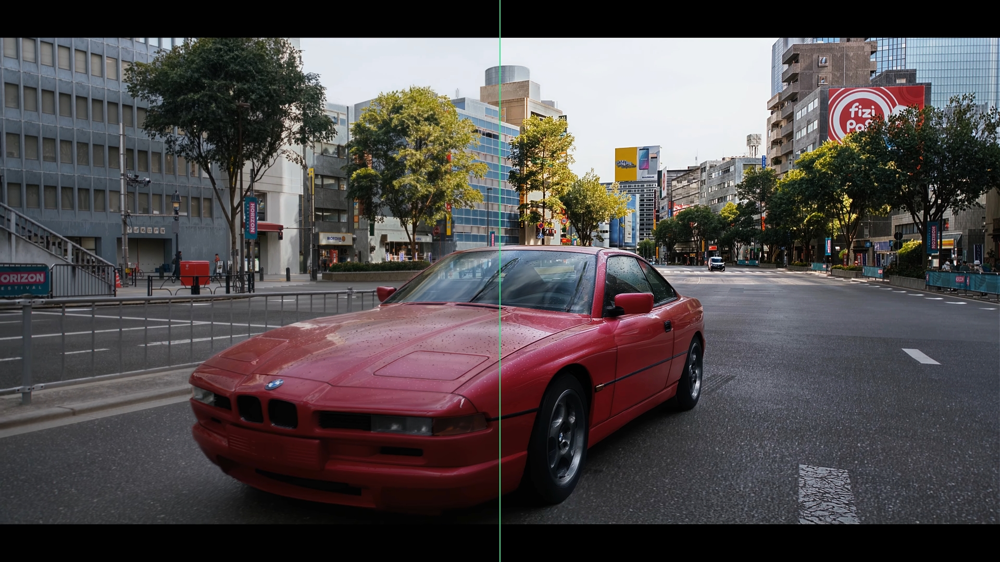
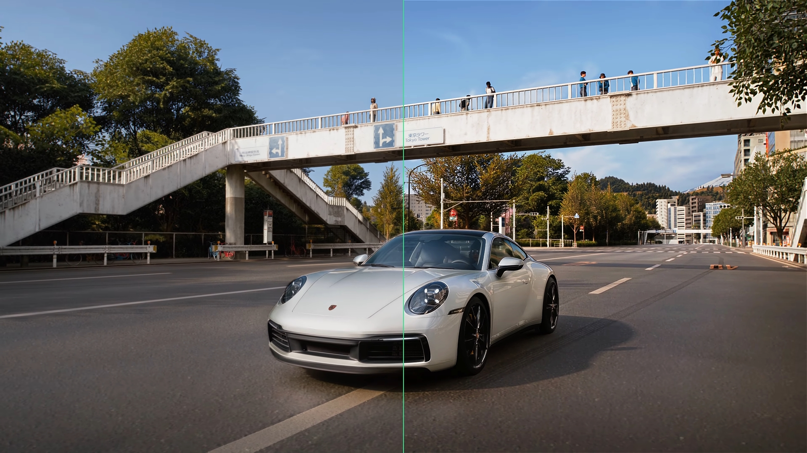

#### 🎬 VIDEO FILTER 1.0

**Расширение для Google Chrome с настраиваемыми SVG-фильтрами для видео.**
Накладывает цепочку постобработки на **все видео** в браузере в реальном времени без копирования кадров в canvas и рассинхронизации звука:
**Auto-Exposure** (адаптивная ночная яркость) → **FakeHDR** → **LumaSharpen** → **FXAA**. 

🌐 **Язык:** [English](./README.md) | **Русский** 

#### ✨ Возможности

* **4-этапный тракт обработки:** плавная настройка ночной яркости, локального контраста, резкости по яркостному каналу и сглаживания граней с помощью ползунков.
* **Сравнение До / После:** оценка эффекта в реальном времени (0%–100%) с помощью подвижной вертикальной зелёной линии внутри одного SourceGraphic.
* **Пресеты и бэкап в JSON:** 5 встроенных пресетов (*Оригинал*, *Ночь*, *Кино*, *Резкость + FXAA*, *Плоское*), сохранение собственных пресетов, а также экспорт и импорт в .json.
* **Двуязычный интерфейс:** мгновенное переключение **Русский / English** (i18n.js). Настройки языка и линии сравнения хранятся отдельно в vfPreferences (chrome.storage) и не сбиваются при смене пресетов.

#### 🚀 Установка

1. Создайте папку video-filter и поместите в неё все файлы расширения:
manifest.json, filter.js, i18n.js, content.js, background.js, popup.html, popup.css, popup.js.
2. Откройте chrome://extensions/ и включите **Режим разработчика** (в правом верхнем углу).
3. Нажмите **Загрузить распакованное расширение** и выберите папку video-filter.
4. Закрепите иконку **VIDEO FILTER** на панели инструментов браузера.

**Обновление:** замените файлы в папке, нажмите кнопку обновления (↻) на карточке расширения в chrome://extensions/ и **перезагрузите открытые вкладки с видео**, чтобы обновились скрипты страницы. 

#### 🎛 Управление и горячие клавиши

* **Открыть панель:** клик по иконке расширения на панели браузера.
* **Вкл / выкл фильтр:** горячая клавиша Alt+Shift+F или тумблер **ON/OFF** в шапке.
* **Вкл / выкл отдельный этап:** тумблер **Блок активен** в каждой из 4 секций.
* **Режим До / После:** нажмите **Показать линию**, двигайте ползунок **Положение линии** (0%–100%) или нажмите **По центру** (50%). Кнопка **Скрыть линию** возвращает эффекты на весь кадр. *(Недоступно на защищённых страницах Chrome и в режиме «Картинка в картинке»).*
* **Пресеты:** выбирайте встроенные чипы, введите имя и нажмите **+ Сохранить** для своего пресета или × для его удаления.
* **Бэкап и сброс:** кнопки **↓ Экспорт .json**, **↑ Загрузить .json**, ссылка **Сброс** и кнопка отключения фильтра на текущем сайте внизу панели.

#### 🛠 Как работает обработка (SourceGraphic)

Исходный видеопоток проходит через последовательный конвейер из четырёх этапов внутри одного SVG-фильтра: 

1. **Auto-Exposure (Автоэкспозиция):** вычисляет карту яркости сцены (feColorMatrix + сильное размытие feGaussianBlur), формирует адаптивную маску (feComponentTransfer) и мягко осветляет тёмные участки через feComposite.
2. **FakeHDR (Локальный контраст):** выделяет мелкие детали с помощью размытия и вычитания (feGaussianBlur + feComposite), корректирует тональный баланс 9-точечной кривой (feComponentTransfer) и усиливает насыщенность цветов (feColorMatrix).
3. **LumaSharpen (Резкость по яркости):** анализирует перепады яркости через две встречные разности (±0.24), повышая чёткость контуров без появления цветных ореолов.
4. **FXAA (Сглаживание граней):** находит резкие контрастные границы (|L−B| с порогом отсечки шума), строит альфа-маску краёв и локально сглаживает «лесенки» только вдоль контуров.

В финале обработанное изображение смешивается с оригиналом в заданной пропорции (mix) и обрезается по исходной альфа-маске (operator="in").

*(Управляется тумблерами этапов enabled, aeOn, hdrOn, shOn, fxaaOn и 20 настраиваемыми параметрами, значения которых по умолчанию соответствуют пресету **«Оригинал»**).*

